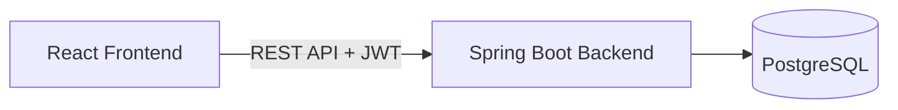
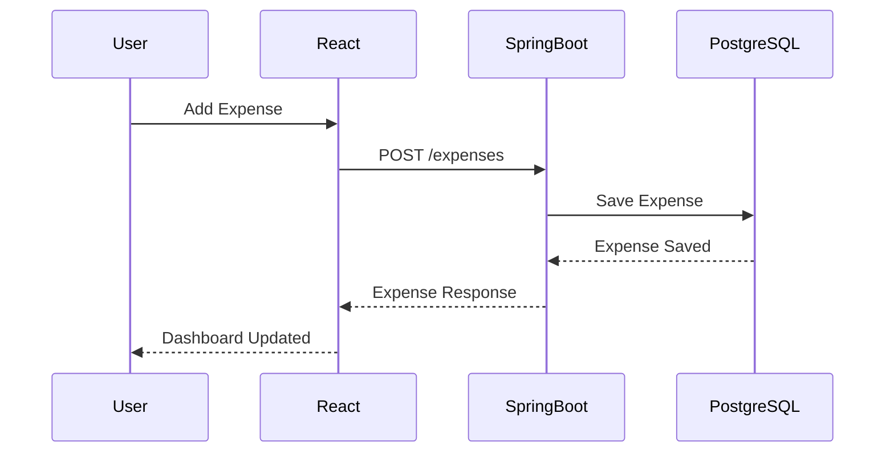
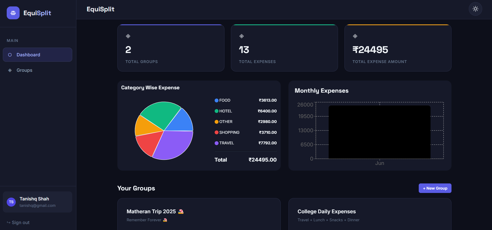
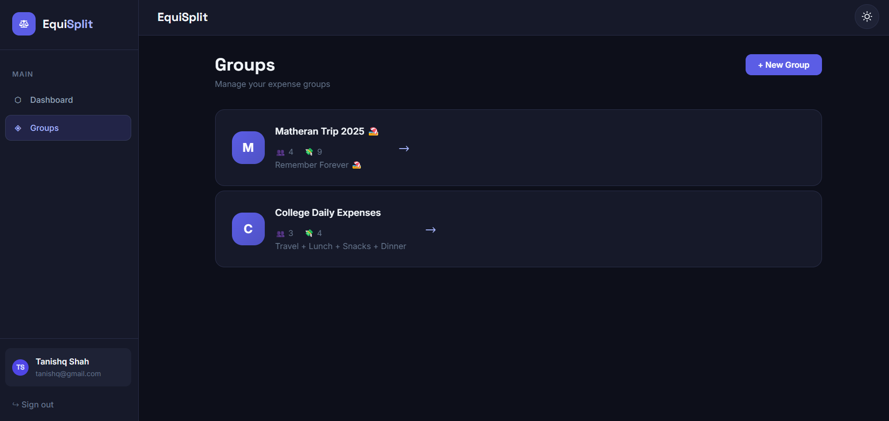
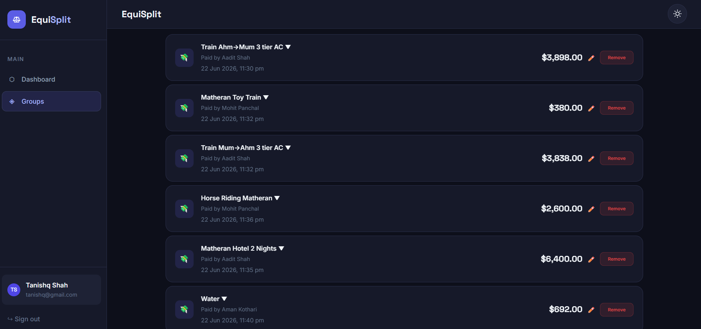
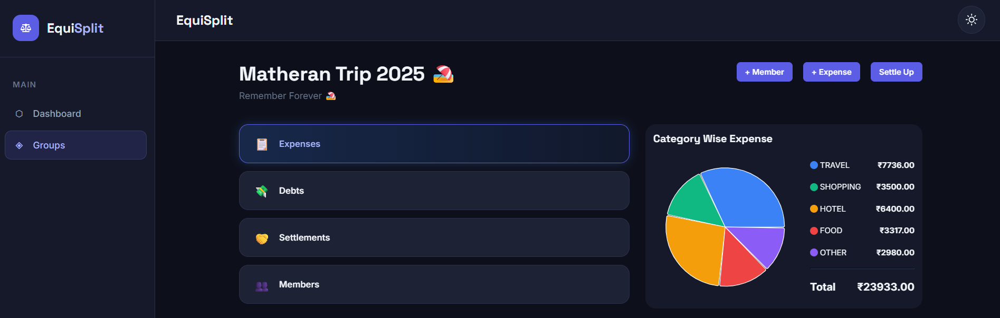
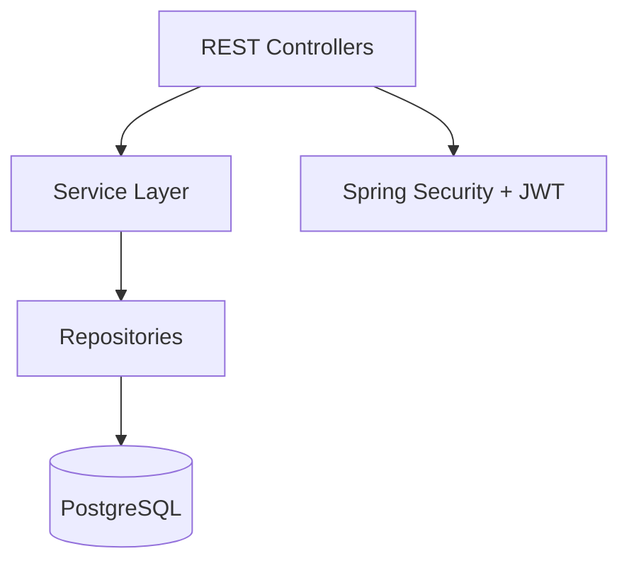
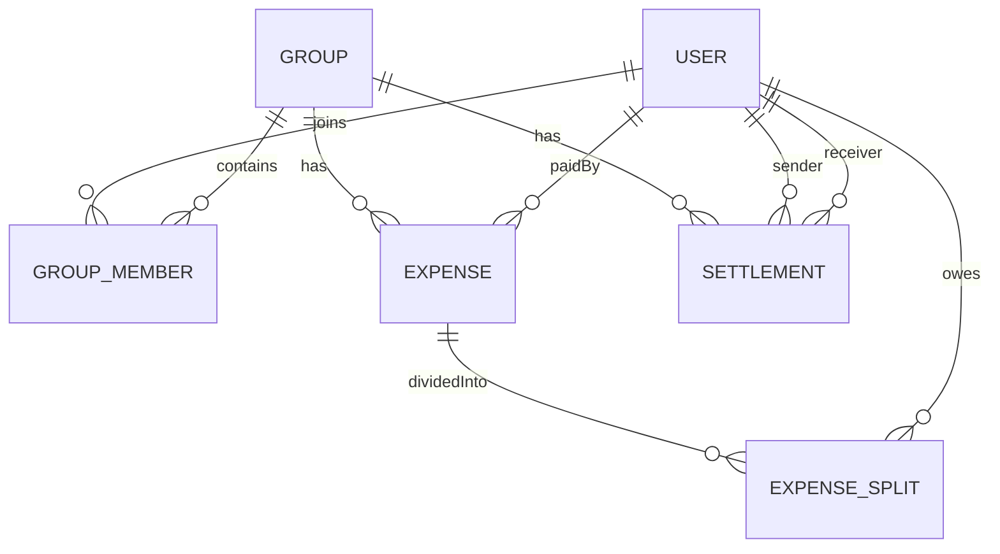
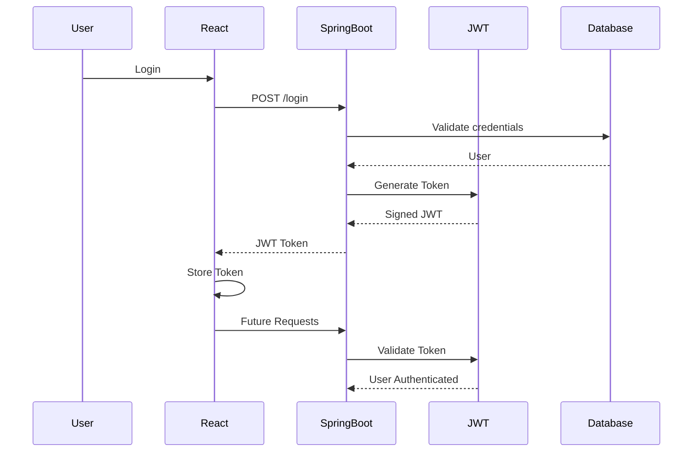

# ⚖️ EquiSplit

An expense sharing platform that helps users to manage group expenses and settle debts efficiently.It simplifies expense management for trips, roommates, friends, and teams by providing a seamless way to create groups, record shared expenses, calculate balances, and track settlements.

The settlement of groups are simplified using Min Cash Flow algorithm.

---

## 🚀 Live Demo

| Service | URL |
|----------|-----|
| 🌐 Live Demo | [App](https://equisplit-app.vercel.app/) |
| ⚙ Backend API | [Backend](https://equisplit-dqw0.onrender.com/) |
| ❤️ Health Endpoint | [Health Point](https://equisplit-dqw0.onrender.com/api/health) |

---

# Architecture



---

# Request Flow



---

# Features

| Category | Features |
|-----------|----------|
| Authentication | JWT Login • Registration |
| Groups | Create Groups • Edit Groups • Delete Groups |
| Members | Add Members • Remove Members |
| Expenses | Create • Edit • Delete Expenses |
| Split Types | Equal • Exact Amount • Percentage |
| Settlement | Record Settlements |
| Dashboard | Total Groups • Total Expenses • Expense Analytics |
| Security | JWT Authentication |

---

# Screenshots

### Dashboard



---

### Groups



---

### Expense Details



---

### Analytics



---

# Core Functionalities

✅ User Authentication

✅ Group Management

✅ Expense Tracking

✅ Multiple Split Algorithms

✅ Balance Calculation

✅ Settlement Tracking

---

# Backend Architecture

EquiSplit follows a layered architecture that separates concerns between presentation, business logic, persistence, and security.



The backend is built using **Spring Boot** and follows RESTful design principles. Every request passes through JWT authentication before reaching the business layer. Services contain all business logic while repositories handle database interactions through Spring Data JPA.

---

# Database Design

The application models relationships between users, groups, expenses, settlements, and expense splits.



---

# Authentication Flow



JWT authentication removes the need for server-side sessions, allowing the backend to remain stateless and scalable.

---

# Security

The application implements multiple security layers.

- JWT Authentication
- BCrypt Password Hashing
- Stateless Sessions
- Input Validation
- Global Exception Handling
- CORS Configuration
- Protected REST APIs

Passwords are never stored in plain text.

---

# API Design

The backend exposes RESTful APIs grouped by resource.

| Module | Responsibilities |
|---------|------------------|
| Authentication | Login, Register |
| Groups | CRUD Operations |
| Members | Add / Remove Members |
| Expenses | CRUD + Split Calculation |
| Settlements | Record Payments |

## Context API

Global authentication state is managed using Context.

It stores

- Logged-in user
- JWT token
- Login status
- Logout functionality

This avoids unnecessary prop drilling across the application.

---

# Project Structure

```
EquiSplit/

├── backend/
│
│   ├── config/
│   │     ├── SecurityConfig.java
│   │     ├── JwtAuthenticationFilter.java
│   │     └── OpenApiConfig.java
│   │
│   ├── controller/
│   │     ├── AuthController.java
│   │     ├── GroupController.java
│   │     ├── ExpenseController.java
│   │     ├── SettlementController.java
│   │     └── DashboardController.java
│   │
│   ├── service/
│   │     ├── AuthService.java
│   │     ├── GroupService.java
│   │     ├── ExpenseService.java
│   │     ├── SettlementService.java
│   │     └── DashboardService.java
│   │
│   ├── repository/
│   │
│   ├── entity/
│   │
│   ├── dto/
│   │
│   ├── security/
│   │
│   └── exception/
│
├── frontend/
│
└── README.md
```

---

# Tech Stack

| Layer | Technology |
|--------|------------|
| Backend | Java |
| Framework | Spring Boot |
| Authentication | JWT |
| Database | PostgreSQL |
| ORM | Spring Data JPA / Hibernate |
| Build Tool | Maven |

---

# Deployment

| Component | Platform |
|------------|----------|
| Frontend | Vercel |
| Backend | Render |
| Database | Neon PostgreSQL |

The application is deployed as separate frontend and backend services communicating through REST APIs.

---

# Running Locally

## Clone the Repository

```bash
git clone https://github.com/Tanishq7361/EquiSplit.git

cd EquiSplit
```

---

## Backend

```bash
cd backend

mvn clean install

mvn spring-boot:run
```

Runs on

```
http://localhost:8080
```

---

## Frontend

```bash
cd frontend

npm install

npm start
```

Runs on

```
http://localhost:3000
```

---

# Environment Variables

## Backend

```
SPRING_DATASOURCE_URL=

SPRING_DATASOURCE_USERNAME=

SPRING_DATASOURCE_PASSWORD=

JWT_SECRET=
```

---

## Frontend

```
REACT_APP_API_URL=http://localhost:8080/api/v1
```

---

# Build for Production

Backend

```bash
mvn clean package
```

Frontend

```bash
npm run build
```
---

## Stateless Authentication with JWT

Instead of maintaining server-side sessions, the application uses **JSON Web Tokens (JWT)**.

### Benefits

- Stateless backend
- Easy horizontal scaling
- Reduced server memory usage
- Suitable for REST APIs

Each protected request passes through a JWT authentication filter before reaching the controller layer.

---

## Layered Architecture

The backend follows a layered architecture.

```
Controller
      │
      ▼
Service Layer
      │
      ▼
Repository Layer
      │
      ▼
Database
```

This separation keeps business logic independent from HTTP and persistence concerns.

---

## Expense Splitting Strategy

Instead of storing only the total expense amount, every expense creates dedicated **ExpenseSplit** records.
```

This significantly simplifies

- balance calculation
- settlement generation
- reporting

```
---

# Security Considerations

The application incorporates multiple security best practices.

✅ Password hashing using BCrypt

✅ JWT authentication

✅ Input validation

✅ Global exception handling

✅ Authorization checks

Only authenticated users can access or modify their own groups and expenses.

---

# Lessons Learned

Building EquiSplit provided practical experience with

- REST API Design
- Spring Security
- JWT Authentication
- Hibernate Relationships
- Production Deployment

---

# Key Highlights

✔ Secure JWT Authentication

✔ Multiple Expense Splitting Algorithms

✔ Interactive Analytics Dashboard

✔ Layered Backend Design

✔ PostgreSQL Relational Data Model

---

# Contributing

Contributions are welcome.

1. Fork the repository

2. Create a feature branch

```bash
git checkout -b feature/new-feature
```

3. Commit your changes

```bash
git commit -m "feat: add new feature"
```

4. Push to your fork

```bash
git push origin feature/new-feature
```

5. Open a Pull Request

---

# Acknowledgements

This project was developed as a practical exploration of modern fullstack software engineering concepts including

- Spring Boot
- PostgreSQL
- JWT Authentication
- Financial System Design

---

# Connect With Me

**Tanishq Shah**

- GitHub: https://github.com/Tanishq7361
- LinkedIn: https://www.linkedin.com/in/tanishq-shah7/
- Email: tanishq7361@gmail.com

---

# License

This project is licensed under the MIT License.
